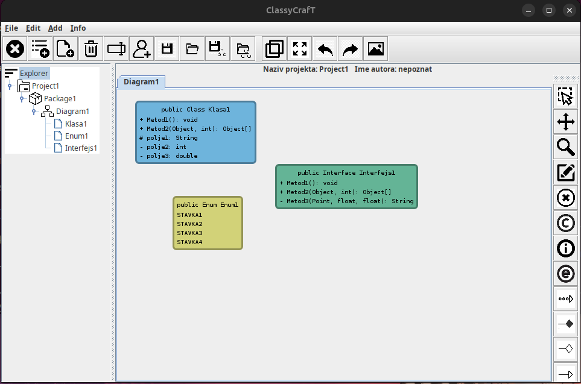

# ClassyCrafT

Desktop app for building UML **class diagrams**. Java 17 + Swing.

Made as a team project at the Faculty of Computer Science (RAF) for the Software Design course.

**Authors:** Matija Radulovic (RN 134/23), Jovana Lazic (RN 24/22)



## Features

- Project tree (left panel): **Project → Package → Diagram**, with add / rename / delete
- Diagram elements: **class, interface, enum**, each with attributes, methods and visibility
- Connections: **dependency, aggregation, composition, generalization**
- Canvas tools: select, move, zoom, edit content, delete, duplicate, fit to view
- **Undo / redo** (command pattern)
- **Save / load projects** as JSON
- **Diagram templates**: save a diagram to a file and load it into another one
- **Export** the active diagram as a PNG
- Project author editing, "About us" dialog, error popups + console/file logging

## Requirements

- JDK 17+ (tested compiling on 21). A full JDK is needed, not just a JRE.
- Maven

## Build & run

```bash
cd ClassyCrafT
mvn compile
mvn exec:java -Dexec.mainClass=raf.dsw.classycraft.app.AppCore
```

Or open `ClassyCrafT/` in IntelliJ and run `raf.dsw.classycraft.app.AppCore`.

## Usage

1. Use the toolbar / **Add** menu to create a project, then a package, then a diagram in the tree.
2. Open the diagram in a tab.
3. Pick a tool from the side toolbar (class / interface / enum / connection) and click on the canvas.
   For connections, click the source element, then the target.
4. Save with the toolbar's save button (select the project in the tree first).

## Architecture

The app follows **MVC** with an observer-based update path. The view never changes itself; it only reacts to the model.

- **Model**: the `ClassyNode` tree (`ProjectExplorer → Project → Package → Diagram → elements`) under `core/treemodel/`.
- **View**: the Swing tree (`ClassyTreeView`) and the diagram canvas (`DiagramView` + painters).
- **Controller**: Swing `Action`s, the canvas mouse listeners, `StateManager` + states, and `Command`s.

How a change travels (example: user adds a class to a diagram):

1. A mouse click on the canvas goes to `DiagramView` → `StateManager` → the current `State` (`ClassState`).
2. The state builds the element and hands a `Command` (`ClassAddCommand`) to the `CommandManager`, which runs it (this is what makes undo/redo possible).
3. The command changes the **model**: `Diagram.AddChild(element)`.
4. `Diagram` is an `IPublisher`, so it fires a `NodeChildrenClassyEvent` to its subscribers.
5. `ClassyTreeI` (subscribed to every diagram) receives it and inserts/removes the matching `ClassyTreeItem` in the `DefaultTreeModel` → **the tree updates**. `PackageTabbedPane` also listens to diagrams/packages, for tab titles and tabs.
6. The command also adds the painter to `DiagramViewModel`, which fires a `PaintClassyEvent` → `DiagramView` calls `repaint()` → **the canvas updates**.

The same loop is used for renames (`NodeChangedClassyEvent`) and tree selection (`SelectionClassyEvent` from `ClassyTreeI` → `PackageViewPane` opens the right package). Events are batched (`NodeChildrenClassyEvent` carries lists), so loading many nodes updates the view once.

The model is edited first and the views follow, so the tree and canvas can't drift apart.

| Package | What's in it |
|---|---|
| `controller/` | Swing `Action`s (`ActionManager` holds them all) and `events/` |
| `core/treemodel/` | Model: composite tree (`ClassyNode`), nodes (`Project`, `Package`, `Diagram`, `ClassyClass`, connections...), factories |
| `core/state/` | **State** pattern: one state per canvas tool (`ClassState`, `MoveState`, `ZoomState`...), driven by `StateManager` |
| `core/msggen/` | Publisher/subscriber message generator + console/file loggers |
| `core/serializer/` | `JacksonUtil` - JSON save/load |
| `gui/swing/main/` | `MainFrame`, menu/toolbars, **Command** classes + `CommandManager` for undo/redo |
| `gui/swing/main/pkgview/` | Diagram tabs, `DiagramView` (canvas), `DiagramViewModel` |
| `gui/swing/painters/` | One painter per element type, created by `PainterSimpleFactory` |
| `gui/swing/treeview/` | Project tree view/controller |
| `gui/swing/popups/` | Dialogs (edit class content, about us) |

### Design patterns

Some of the design patterns that were showcased in this project:

| Pattern | Where | Role |
|---|---|---|
| **Composite** | `ClassyNode` / `ClassyNodeComposite` / `ClassyNodeLeaf` | Project, package, diagram and diagram elements form one tree, handled uniformly (`AddChild`, `removeChild`, `FullNameGet`) |
| **Observer** | `IPublisher` / `ISubscriber`; `Diagram`, `ClassyTreeI`, `DiagramViewModel`, `MessageGenerator` | Model → events (`controller/events/`) → tree, tabs, canvas, loggers and error popups react |
| **State** | `core/state/` (`State`, `StateManager`, `SelectionState`, `MoveState`, `ZoomState`, `ClassState`...) | Each canvas tool is a state; the same mouse events do different things depending on the active tool. E.g. `SelectionState` handles click / ctrl-click / rubber-band selection, `MoveState` drags the selection |
| **Command** | `AbstractCommand`, `CommandManager`, `*AddCommand`, `*RemoveCommand`, `MoveCommand`, `EditCommand` | Every canvas change is an object with `doCommand` / `undoCommand`, so undo/redo is a pointer moving in the command list |
| **Abstract Factory / Factory Method** | `AbstractNodeFactory` → `ProjectFactory`, `PackageFactory`, `ExplorerFactory`, `InterClassFactory`, `ConnectionFactory` | `ClassyTreeI.CreateNode` asks `ClassyRepository.getFactoryOf(parentType)` for the factory matching the parent, so the tree creates the right child without knowing concrete classes (project → package → diagram) |
| **Simple Factory** | `PainterSimpleFactory.makePainter(element)` | Picks the painter class for an element |
| **Prototype** | `Interclass.CopyGet()` (`ClassyClass`, `ClassyInterface`, `ClassyEnum`) | Each tool state (`InterClassStateAbs`) holds a prototype element and clones it on click; the duplicate action (`CloneAction`) reuses the same copy |
| **Singleton** | `ApplicationFramework`, `MainFrame` | Single access point to the app core and main window |
| **Template Method** | `InterClassStateAbs`, `ConnectionStateAbs` | Shared click logic for class/interface/enum and connection tools; subclasses only provide the prototype/type |


Flow of adding a class (click on canvas → `DiagramView` → `StateManager` → `ClassState` → `ClassAddCommand` → `CommandManager` → painter added and repainted):
see [`uml/dijagram_toka.png`](uml/dijagram_toka.png).
